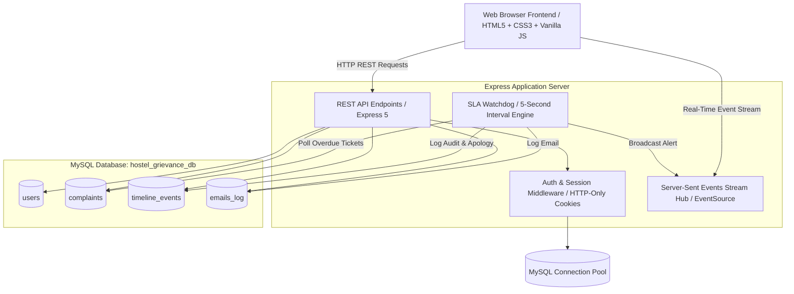

# IntegraCare :: Integral University Hostel Grievance Redressal Portal
## Technical Working, Architecture, Database & Usage Documentation

---

## 1. System Overview

**IntegraCare** is a full-stack, enterprise-grade residence grievance redressal web application tailored for **Integral University Hostels (Lucknow)**. The system streamlines complaint registration, automated category-based routing to domain supervisors, on-field technician dispatch, transparent resolution tracking, and strict 24-hour Service Level Agreement (SLA) enforcement with automated escalation.

### Key Highlights
- **Role-Based Access Control (RBAC):** Three distinct personas—**Students**, **Domain Supervisors**, and the **Chief Provost**.
- **Real-Time Live Synchronization:** Powered by Server-Sent Events (SSE) for instant dashboard updates without page refreshing.
- **Automated 24-Hour SLA Watchdog:** Recurring background cron monitoring complaint deadlines, flagging breaches, alerting supervisors, escalating to the Chief Provost, and dispatching official apology notices to students.
- **Relational Integrity:** Backed by **MySQL 8.0** with connection pooling (`mysql2/promise`) and transactional audit logging.
- **Supported Residential Halls:**
  - **Boys Hostels:** `Hall 1 (Boys)`, `Hall 2 (Boys)`, `Hall 3 (Boys)`
  - **Girls Hostels:** `Hall 1 (Girls)`, `Hall 2 (Girls)`, `Hall 3 (Girls)`

---

## 2. System Architecture



---

## 3. Database Architecture & Schema

The portal uses **MySQL 8.0** under the database name:
```sql
CREATE DATABASE IF NOT EXISTS `hostel_grievance_db` CHARACTER SET utf8mb4 COLLATE utf8mb4_unicode_ci;
```

### 3.1. Tables Overview

| Table Name | Purpose | Primary Key | Key Relationships / Indexes |
| :--- | :--- | :--- | :--- |
| **`users`** | Resident students, supervisors, and administrative provost accounts | `id` (VARCHAR 64) | `enrollment_no` (UNIQUE INDEX), `email` (UNIQUE) |
| **`complaints`** | Master ledger of all grievances filed across residential halls | `id` (VARCHAR 64) | `ticket_number` (UNIQUE), `student_id`, `assigned_supervisor_id` |
| **`timeline_events`** | Granular, timestamped audit trail of actions taken on every ticket | `id` (INT AUTO_INCREMENT) | `complaint_id` (INDEX), references `complaints.id` |
| **`emails_log`** | Outbox audit log for transactional email notices sent by the portal | `id` (VARCHAR 64) | `ticket_number`, `recipient_email` |

---

### 3.2. Detailed Table Schemas

#### Table 1: `users`
Stores student residents, domain maintenance supervisors, and chief provost profiles.

```sql
CREATE TABLE IF NOT EXISTS users (
  id VARCHAR(64) PRIMARY KEY,
  role ENUM('student', 'supervisor', 'provost') NOT NULL,
  category VARCHAR(32) NULL,                      -- Maintenance domain (for supervisors: Electrical, Plumbing, etc.)
  name VARCHAR(128) NOT NULL,                     -- Full name
  email VARCHAR(128) NOT NULL UNIQUE,             -- Official institutional email
  password VARCHAR(255) NOT NULL DEFAULT 'password123',
  enrollment_no VARCHAR(64) NULL UNIQUE,          -- Official University Enrollment No. (Students)
  student_id VARCHAR(64) NULL,                    -- Student ID reference
  hostel VARCHAR(128) NULL,                       -- Assigned Hostel (Hall 1 (Boys), Hall 2 (Boys), Hall 1 (Girls), etc.)
  room VARCHAR(32) NULL,                          -- Room Number (e.g., K-312, 104)
  phone VARCHAR(32) NULL,                         -- Contact phone number
  title VARCHAR(128) NULL,                        -- Designation / academic program
  created_at DATETIME DEFAULT CURRENT_TIMESTAMP,
  INDEX idx_enrollment (enrollment_no)
) ENGINE=InnoDB;
```

#### Table 2: `complaints`
Stores grievances through their full lifecycle from creation to verification and resolution.

```sql
CREATE TABLE IF NOT EXISTS complaints (
  id VARCHAR(64) PRIMARY KEY,                     -- Ticket UUID / identifier
  ticket_number VARCHAR(64) NOT NULL UNIQUE,      -- Formatted ticket number: IU-HST-2026-XXXX
  student_id VARCHAR(64) NOT NULL,                -- Student Enrollment / ID
  enrollment_no VARCHAR(64) NOT NULL,             -- Student Enrollment Number
  student_name VARCHAR(128) NOT NULL,             -- Student Full Name
  student_email VARCHAR(128) NOT NULL,            -- Student Email
  hostel VARCHAR(128) NOT NULL,                   -- Hostel Hall (Hall 1 (Boys), etc.)
  room VARCHAR(32) NOT NULL,                      -- Room Number
  category ENUM('Electrical', 'Plumbing', 'Carpentry', 'Food', 'Discipline') NOT NULL,
  title VARCHAR(255) NOT NULL,                    -- Complaint summary / subject
  description TEXT NOT NULL,                      -- Comprehensive issue details
  priority ENUM('Normal', 'High', 'Urgent') DEFAULT 'Normal',
  status ENUM('Pending Assignment', 'In Progress', 'Resolved') DEFAULT 'Pending Assignment',
  created_at DATETIME NOT NULL,                   -- Grievance submission timestamp
  deadline DATETIME NOT NULL,                     -- 24-Hour SLA Target (created_at + 24 hours)
  assigned_supervisor_id VARCHAR(64) NOT NULL,    -- Foreign reference to supervisor in users table
  assigned_supervisor_name VARCHAR(128) NOT NULL, -- Supervisor name
  professional_name VARCHAR(128) NULL,            -- Dispatched technician name
  professional_phone VARCHAR(32) NULL,            -- Dispatched technician contact phone
  expected_visit_time VARCHAR(128) NULL,          -- Scheduled arrival window
  professional_notes TEXT NULL,                   -- Instructions or notes for technician
  professional_assigned_at DATETIME NULL,         -- Dispatch timestamp
  resolution_notes TEXT NULL,                     -- Work completion report & verification notes
  resolved_at DATETIME NULL,                      -- Resolution timestamp
  resolved_by VARCHAR(128) NULL,                  -- Name of staff member who verified resolution
  sla_breached TINYINT(1) DEFAULT 0,              -- 1 if deadline passed without resolution
  apology_email_sent TINYINT(1) DEFAULT 0         -- 1 if automated apology email was dispatched
) ENGINE=InnoDB;
```

#### Table 3: `timeline_events`
Chronological event ledger providing a complete immutable audit trail for every grievance.

```sql
CREATE TABLE IF NOT EXISTS timeline_events (
  id INT AUTO_INCREMENT PRIMARY KEY,
  complaint_id VARCHAR(64) NOT NULL,              -- Target complaint ticket number / ID
  time DATETIME NOT NULL,                         -- Event timestamp
  actor VARCHAR(128) NOT NULL,                    -- Actor (Student, Supervisor, System Router, SLA Watchdog)
  action TEXT NOT NULL,                           -- Detailed description of activity
  INDEX idx_complaint (complaint_id)
) ENGINE=InnoDB;
```

#### Table 4: `emails_log`
Transactional email audit log for outbox inspection.

```sql
CREATE TABLE IF NOT EXISTS emails_log (
  id VARCHAR(64) PRIMARY KEY,
  ticket_number VARCHAR(64) NOT NULL,
  type VARCHAR(64) NOT NULL,                      -- REGISTRATION, TECHNICIAN_ASSIGNED, RESOLVED, SLA_BREACH_APOLOGY
  recipient_email VARCHAR(128) NOT NULL,
  subject VARCHAR(255) NOT NULL,
  body_html LONGTEXT NOT NULL,
  sent_at DATETIME NOT NULL
) ENGINE=InnoDB;
```

---

## 4. User Personas & Portal Workflows

### 4.1. Student Resident Persona
- **Authentication:** Log in using their official University **Enrollment Number** (e.g. `IU/2023/10452`) and password. First-time residents can register via the self-registration modal by choosing their hall (`Hall 1 (Boys)`, `Hall 2 (Boys)`, `Hall 3 (Boys)`, `Hall 1 (Girls)`, `Hall 2 (Girls)`, or `Hall 3 (Girls)`) and room number.
- **Filing a Grievance:**
  1. Click **+ Raise Grievance**.
  2. Select Category (`Electrical`, `Plumbing`, `Carpentry`, `Food`, `Discipline`).
  3. Specify Urgency Level (`Normal`, `High`, `Urgent`).
  4. Provide subject title and detailed issue description.
  5. On submission, the grievance is saved to MySQL, automatically tagged with a 24-hour deadline, assigned to the category supervisor, and confirmed via email.
- **Tracking & Real-Time Inspection:**
  - View live status cards displaying current phase (`Pending Assignment`, `In Progress`, `Resolved`).
  - Active **24-hour countdown ticker** showing exact hours, minutes, and seconds remaining.
  - View assigned field technician contact number and arrival window.
  - Open the ticket timeline to inspect supervisor notes and resolution verification.

---

### 4.2. Maintenance Supervisor Persona
Supervisors manage complaints belonging strictly to their maintenance category:
- **⚡ Electrical Maintenance Supervisor** (`Rajesh Verma` / `electrical.hostel@iul.ac.in`)
- **🚰 Plumbing & Water Systems Supervisor** (`Suresh Patel` / `plumbing.hostel@iul.ac.in`)
- **🪚 Carpentry & Furniture Supervisor** (`Mohan Lal` / `carpentry.hostel@iul.ac.in`)
- **🍲 Mess & Catering Quality Supervisor** (`Anil Deshmukh` / `food.hostel@iul.ac.in`)
- **⚖️ Hostel Warden & Discipline Proctor** (`Col. R. Singh` / `discipline.hostel@iul.ac.in`)

#### Supervisor Workflow:
1. **Queue Inspection:** Review incoming tickets with real-time SLA badges.
2. **Dispatch Technician:** Click **Assign Professional**, enter technician name, phone number, scheduled visit time, and instructions. Status moves to **In Progress**.
3. **Mark Resolved:** Once physical inspection and repair are completed, click **Mark Resolved**, enter resolution notes (e.g. "Replaced capacitor and serviced ceiling fan assembly"), and confirm.

---

### 4.3. Chief Provost Executive Directorate
- **User:** `Prof. (Dr.) Mohammad Faisal` (`provost@iul.ac.in`)
- **Functional Modules:**
  1. **Master Grievances Surveillance Module:**
     - Real-time university-wide metrics: Total Grievances, In Progress, Resolved Count, Active 24h SLA Breaches, and Overall SLA Compliance Rate.
     - Category breakdown distribution.
     - **Master Hostel Grievances Ledger:** Complete searchable and filterable directory covering all residence halls (`Hall 1`, `Hall 2`, `Hall 3` for Boys and Girls) with both desktop Table and mobile Card adaptive views.
     - Ability to inspect any ticket's full timeline, supervisor notes, and audit history.
  2. **Supervisor Management Console:**
     - **Active Supervisor Directory:** Inspect all registered maintenance supervisors across Electrical, Plumbing, Carpentry, Food, and Discipline domains.
     - **Live Department Workload & Performance:** Per-supervisor counters for active complaints, pending assignment, resolved tickets, breached tickets, and individual SLA compliance percentage.
     - **Onboard New Supervisor:** Form modal to register new domain supervisors (`name`, `email`, `phone`, `domain`, `password`, `title`).
     - **Edit Supervisor Profile:** Modify contact numbers, job designations, maintenance domain assignments, or reset login credentials.
     - **Remove / Reassign Supervisor:** Secure supervisor removal with required reassignment of active grievances to designated replacement staff.
     - **Direct Grievance Inspection:** One-click navigation to inspect all grievances assigned to a specific supervisor.

---

## 5. Automated 24-Hour SLA Watchdog

The backend runs an automated background watchdog every 5 seconds (`setInterval(runSlaWatchdog, 5000)` in `server.js`):
1. **Query Overdue Complaints:**
   ```sql
   SELECT * FROM complaints 
   WHERE status != 'Resolved' AND sla_breached = 0 AND deadline < NOW()
   ```
2. **Flag Breach:** Updates `sla_breached = 1` and `apology_email_sent = 1`.
3. **Timeline Event:** Writes an escalation alert to `timeline_events` tagging the System SLA Watchdog.
4. **Automated Apology Dispatch:** Generates an official university notice & apology email dispatched to the student's email, notifying them that the ticket has been escalated directly to the Chief Provost.
5. **Real-time SSE Notification:** Emits `SLA_BREACHED` to connected clients, updating the provost and supervisor interfaces dynamically.

---

## 6. REST API Reference

| Endpoint | Method | Allowed Roles | Description |
| :--- | :--- | :--- | :--- |
| `/api/auth/student-login` | `POST` | Public | Authenticates student via Enrollment Number and password |
| `/api/auth/staff-login` | `POST` | Public | Authenticates supervisor/provost via staff email and password |
| `/api/auth/register` | `POST` | Public | Registers a new student resident with Hall and Room allocation |
| `/api/auth/logout` | `POST` | Any | Clears session cookie (`hostel_session`) |
| `/api/auth/me` | `GET` | Authenticated | Returns current session user object |
| `/api/complaints` | `GET` | Authenticated | Retrieves grievances filtered by authenticated role privileges |
| `/api/complaints` | `POST` | Student | Registers a new grievance; initiates 24h SLA and dynamic supervisor routing |
| `/api/complaints/:id` | `GET` | Authenticated | Fetches single ticket details and complete timeline audit history |
| `/api/complaints/:id/assign-professional` | `POST` | Supervisor, Provost | Dispatches field professional; transitions status to `In Progress` |
| `/api/complaints/:id/status` | `POST` | Supervisor, Provost | Updates status (`Resolved`) and records resolution notes |
| `/api/stats/provost` | `GET` | Provost | Fetches university-wide grievance KPIs and SLA compliance rates |
| `/api/supervisors` | `GET` | Provost | Lists all supervisors with live department workload and SLA metrics |
| `/api/supervisors` | `POST` | Provost | Onboards new domain supervisor with credentials and role assignment |
| `/api/supervisors/:id` | `PUT` | Provost | Updates supervisor details, contact info, domain, and password |
| `/api/supervisors/:id` | `DELETE` | Provost | Deletes supervisor with safety reassignment of active tickets |
| `/api/emails` | `GET` | Authenticated | Returns dispatched email logs for transactional inspection |
| `/api/events` | `GET` | Authenticated | Server-Sent Events (SSE) live notification stream |

---

## 7. Setup & Execution Instructions

### Prerequisites
1. **Node.js**: v18.0.0 or higher
2. **MySQL Server**: 8.0 running locally on default port `3306`

### Database Configuration
Ensure MySQL server is running. Database credentials can be configured via environment variables or edited in `db.js`:
```javascript
const DB_CONFIG = {
  host: process.env.DB_HOST || 'localhost',
  user: process.env.DB_USER || 'root',
  password: process.env.DB_PASSWORD || 'iamEminem#99',
  multipleStatements: true
};
```

### Installation & Launch
```bash
# 1. Install dependencies
npm install

# 2. Start application
npm start
# or: node server.js
```
The server will initialize the database `hostel_grievance_db`, create tables if they do not exist, seed default accounts, and start listening on:
👉 **`http://localhost:3001`**

---

## 8. Default System Credentials

### Students (Login with Enrollment Number)
| Name | Enrollment No. | Password | Hostel Hall | Room |
| :--- | :--- | :--- | :--- | :--- |
| **Mohammad Zaid** | `IU/2023/10452` | `student123` | `Hall 1 (Boys)` | `K-312` |
| **Farhan Ali** | `IU/2023/20188` | `student123` | `Hall 2 (Boys)` | `C-204` |
| **Ayesha Khan** | `IU/2023/30514` | `student123` | `Hall 1 (Girls)` | `H-118` |

### Supervisors & Provost (Login with Email ID)
| Role / Domain | Staff Email ID | Password | Name |
| :--- | :--- | :--- | :--- |
| **Electrical Maintenance** | `electrical.hostel@iul.ac.in` | `super123` | Rajesh Verma |
| **Plumbing & Water** | `plumbing.hostel@iul.ac.in` | `super123` | Suresh Patel |
| **Carpentry & Furniture** | `carpentry.hostel@iul.ac.in` | `super123` | Mohan Lal |
| **Food & Mess Quality** | `food.hostel@iul.ac.in` | `super123` | Anil Deshmukh |
| **Discipline Proctor** | `discipline.hostel@iul.ac.in` | `super123` | Col. R. Singh |
| **Chief Provost** | `provost@iul.ac.in` | `provost123` | Prof. (Dr.) Mohammad Faisal |
